# Poly Haven: Brick & Block textures

**40 assets from [Poly Haven](https://polyhaven.com), dedicated to the public domain under [CC0](https://polyhaven.com/license).** Use them in any game, free or paid, and change them however you like; no credit is needed.

PBR textures as 1K and 2K JPG maps (colour, normal (GL and DX), roughness, AO, displacement and more). 871.9 MB in all.

This is a copy kept by [zuujis-cc0](https://github.com/zuujis-cc0) so game makers can take single files from GitHub. It is not made by or affiliated with Poly Haven: the originals, often in more formats and higher resolutions, are on [polyhaven.com](https://polyhaven.com). If they help you, consider [supporting Poly Haven](https://www.patreon.com/polyhaven/overview).

Every file is listed in [MANIFEST.tsv](MANIFEST.tsv) with its size and SHA-256. More free assets: [the Zuujis collection](https://github.com/zuujis-cc0/free-game-assets#readme).

| | | | |
| :-: | :-: | :-: | :-: |
| <a href="red_brick_pavers">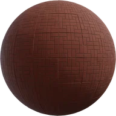</a> <b><a href="red_brick_pavers">Red Brick Pavers</a></b> by Amal Kumar · <a href="https://polyhaven.com/a/red_brick_pavers">source</a> | <a href="red_bricks_02">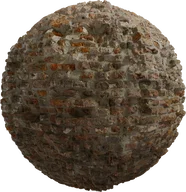</a> <b><a href="red_bricks_02">Red Bricks 02</a></b> by Rob Tuytel · <a href="https://polyhaven.com/a/red_bricks_02">source</a> | <a href="red_bricks_04">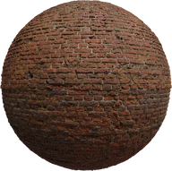</a> <b><a href="red_bricks_04">Red Bricks 04</a></b> by Rob Tuytel · <a href="https://polyhaven.com/a/red_bricks_04">source</a> | <a href="red_sandstone_pavement">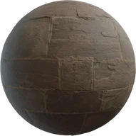</a> <b><a href="red_sandstone_pavement">Red Sandstone Pavement</a></b> by Amal Kumar · <a href="https://polyhaven.com/a/red_sandstone_pavement">source</a> |
| <a href="red_sandstone_tiles">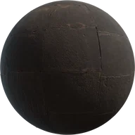</a> <b><a href="red_sandstone_tiles">Red Sandstone Tiles</a></b> by Amal Kumar · <a href="https://polyhaven.com/a/red_sandstone_tiles">source</a> | <a href="red_sandstone_wall">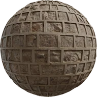</a> <b><a href="red_sandstone_wall">Red Sandstone Wall</a></b> by Amal Kumar · <a href="https://polyhaven.com/a/red_sandstone_wall">source</a> | <a href="ribbed_block_wall">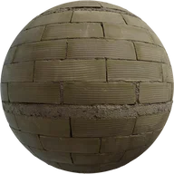</a> <b><a href="ribbed_block_wall">Ribbed Block Wall</a></b> by Amal Kumar · <a href="https://polyhaven.com/a/ribbed_block_wall">source</a> | <a href="rough_block_wall">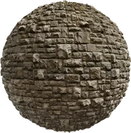</a> <b><a href="rough_block_wall">Rough Block Wall</a></b> by Rob Tuytel · <a href="https://polyhaven.com/a/rough_block_wall">source</a> |
| <a href="sandstone_blocks_04">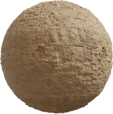</a> <b><a href="sandstone_blocks_04">Sandstone Blocks 04</a></b> by Rob Tuytel · <a href="https://polyhaven.com/a/sandstone_blocks_04">source</a> | <a href="sandstone_blocks_05">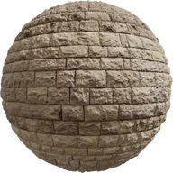</a> <b><a href="sandstone_blocks_05">Sandstone Blocks 05</a></b> by Rob Tuytel · <a href="https://polyhaven.com/a/sandstone_blocks_05">source</a> | <a href="sandstone_blocks_08">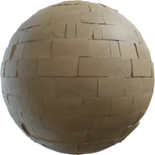</a> <b><a href="sandstone_blocks_08">Sandstone Blocks 08</a></b> by Rob Tuytel · <a href="https://polyhaven.com/a/sandstone_blocks_08">source</a> | <a href="sandstone_brick_wall_01">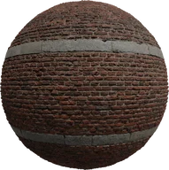</a> <b><a href="sandstone_brick_wall_01">Sandstone Brick Wall 01</a></b> by Rob Tuytel · <a href="https://polyhaven.com/a/sandstone_brick_wall_01">source</a> |
| <a href="seaworn_sandstone_brick">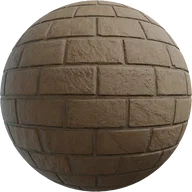</a> <b><a href="seaworn_sandstone_brick">Seaworn Sandstone Brick</a></b> by Dimitrios Savva · <a href="https://polyhaven.com/a/seaworn_sandstone_brick">source</a> | <a href="seaworn_stone_tiles">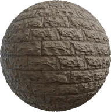</a> <b><a href="seaworn_stone_tiles">Seaworn Stone Tiles</a></b> by Dimitrios Savva · <a href="https://polyhaven.com/a/seaworn_stone_tiles">source</a> | <a href="short_bricks_floor">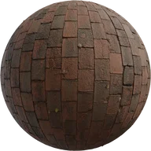</a> <b><a href="short_bricks_floor">Short Bricks Floor</a></b> by Dimitrios Savva · <a href="https://polyhaven.com/a/short_bricks_floor">source</a> | <a href="slumped_mortar_brick">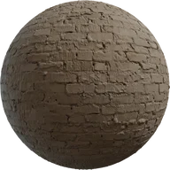</a> <b><a href="slumped_mortar_brick">Slumped Mortar Brick</a></b> by Dimitrios Savva · <a href="https://polyhaven.com/a/slumped_mortar_brick">source</a> |
| <a href="square_brick_floor">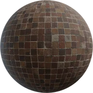</a> <b><a href="square_brick_floor">Square Brick Floor</a></b> by Dimitrios Savva · <a href="https://polyhaven.com/a/square_brick_floor">source</a> | <a href="square_brick_paving">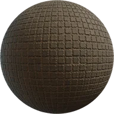</a> <b><a href="square_brick_paving">Square Brick Paving</a></b> by Dimitrios Savva · <a href="https://polyhaven.com/a/square_brick_paving">source</a> | <a href="square_concrete_pavers">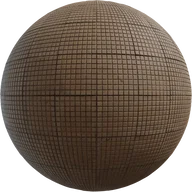</a> <b><a href="square_concrete_pavers">Square Concrete Pavers</a></b> by Amal Kumar · <a href="https://polyhaven.com/a/square_concrete_pavers">source</a> | <a href="square_pavers">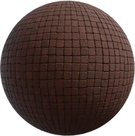</a> <b><a href="square_pavers">Square Pavers</a></b> by Dario Barresi · <a href="https://polyhaven.com/a/square_pavers">source</a> |
| <a href="square_tiled_wall">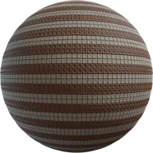</a> <b><a href="square_tiled_wall">Square Tiled Wall</a></b> by Charlotte Baglioni · <a href="https://polyhaven.com/a/square_tiled_wall">source</a> |  <b><a href="square_tiles">Square Tiles</a></b> by Charlotte Baglioni · <a href="https://polyhaven.com/a/square_tiles">source</a> | <a href="stacked_brick_wall">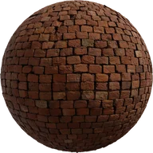</a> <b><a href="stacked_brick_wall">Stacked Brick Wall</a></b> by Amal Kumar · <a href="https://polyhaven.com/a/stacked_brick_wall">source</a> | <a href="stenciled_brick_floor">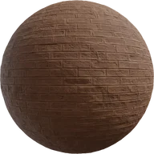</a> <b><a href="stenciled_brick_floor">Stenciled Brick Floor</a></b> by Amal Kumar · <a href="https://polyhaven.com/a/stenciled_brick_floor">source</a> |
| <a href="stone_brick_wall_001">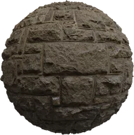</a> <b><a href="stone_brick_wall_001">Stone Brick Wall 001</a></b> by Dimitrios Savva, Rico Cilliers · <a href="https://polyhaven.com/a/stone_brick_wall_001">source</a> | <a href="stone_wall_05">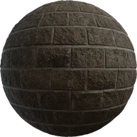</a> <b><a href="stone_wall_05">Stone Wall 05</a></b> by Charlotte Baglioni · <a href="https://polyhaven.com/a/stone_wall_05">source</a> | <a href="t_brick_floor_002">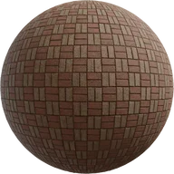</a> <b><a href="t_brick_floor_002">Brick Floor 002</a></b> by Dimitrios Savva, Rico Cilliers · <a href="https://polyhaven.com/a/t_brick_floor_002">source</a> | <a href="t_concrete_wall_002">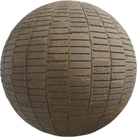</a> <b><a href="t_concrete_wall_002">Concrete Wall 002</a></b> by Dimitrios Savva, Rico Cilliers · <a href="https://polyhaven.com/a/t_concrete_wall_002">source</a> |
| <a href="white_bricks">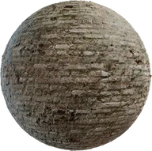</a> <b><a href="white_bricks">White Bricks</a></b> by Rob Tuytel · <a href="https://polyhaven.com/a/white_bricks">source</a> | <a href="white_sandstone_blocks_02">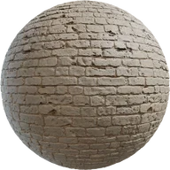</a> <b><a href="white_sandstone_blocks_02">White Sandstone Blocks 02</a></b> by Rob Tuytel · <a href="https://polyhaven.com/a/white_sandstone_blocks_02">source</a> | <a href="white_sandstone_bricks">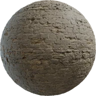</a> <b><a href="white_sandstone_bricks">White Sandstone Bricks</a></b> by Rob Tuytel · <a href="https://polyhaven.com/a/white_sandstone_bricks">source</a> | <a href="white_sandstone_bricks_03">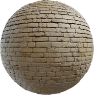</a> <b><a href="white_sandstone_bricks_03">White Sandstone Bricks 03</a></b> by Rob Tuytel · <a href="https://polyhaven.com/a/white_sandstone_bricks_03">source</a> |
| <a href="whitewashed_brick">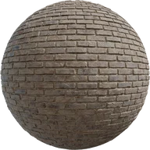</a> <b><a href="whitewashed_brick">Whitewashed Brick</a></b> by Charlotte Baglioni · <a href="https://polyhaven.com/a/whitewashed_brick">source</a> | <a href="worn_brick_floor">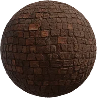</a> <b><a href="worn_brick_floor">Worn Brick Floor</a></b> by Amal Kumar · <a href="https://polyhaven.com/a/worn_brick_floor">source</a> | <a href="worn_brick_path">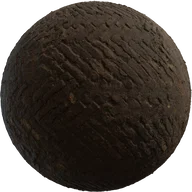</a> <b><a href="worn_brick_path">Worn Brick Path</a></b> by Amal Kumar · <a href="https://polyhaven.com/a/worn_brick_path">source</a> | <a href="worn_brick_wall">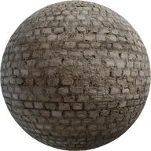</a> <b><a href="worn_brick_wall">Worn Brick Wall</a></b> by Amal Kumar · <a href="https://polyhaven.com/a/worn_brick_wall">source</a> |
| <a href="worn_patterned_pavers">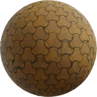</a> <b><a href="worn_patterned_pavers">Worn Patterned Pavers</a></b> by Amal Kumar · <a href="https://polyhaven.com/a/worn_patterned_pavers">source</a> | <a href="yellow_brick">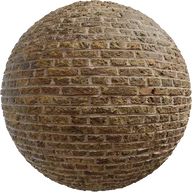</a> <b><a href="yellow_brick">Yellow Brick</a></b> by Rob Tuytel · <a href="https://polyhaven.com/a/yellow_brick">source</a> | <a href="yellow_bricks">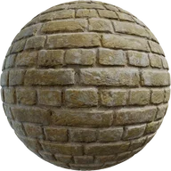</a> <b><a href="yellow_bricks">Yellow Bricks</a></b> by Rob Tuytel · <a href="https://polyhaven.com/a/yellow_bricks">source</a> | <a href="yellow_stone_wall">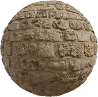</a> <b><a href="yellow_stone_wall">Yellow Stone Wall</a></b> by Sơn Nguyễn · <a href="https://polyhaven.com/a/yellow_stone_wall">source</a> |

---

Kept up to date by this repository's own [update workflow](.github/workflows/update.yml), with code and plan from [cc0-mirror](https://github.com/zuujis-cc0/cc0-mirror). Something wrong? [Open an issue there](https://github.com/zuujis-cc0/cc0-mirror/issues/new) or use the [private report form](https://games.zuujis.com/report).
